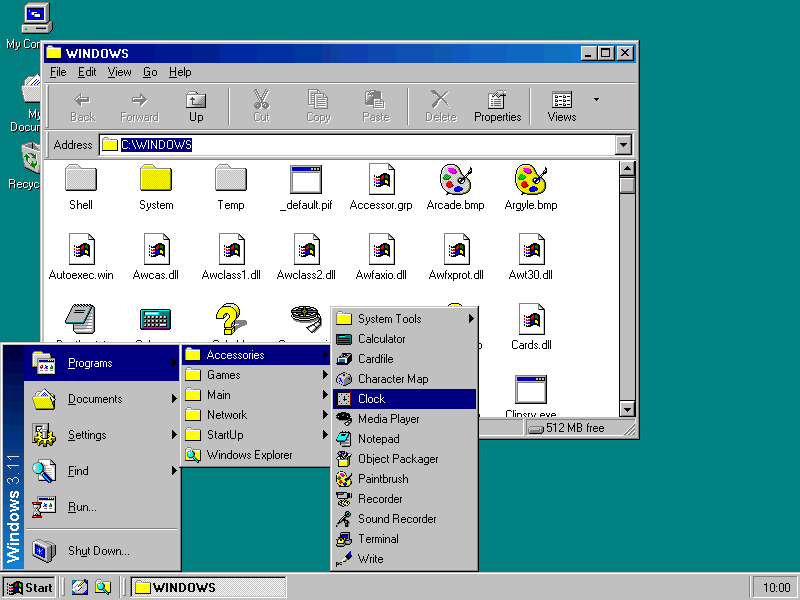
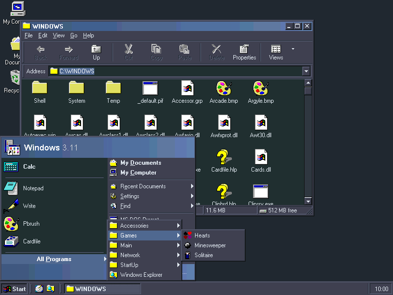

<p align="center">
  
</p>

<p align="center">
  
  
  
  <a href="LICENSE"></a>
  <a href="https://ko-fi.com/focsy"></a>
</p>

<p align="center">
  <b>The Windows 98 desktop for Windows 3.1 and 3.11.</b><br>
  A replacement for Program Manager: desktop, taskbar, Start menu, folders and Explorer, as Windows 98 Second Edition drew them.<br>
  A reimplementation of Calmira, written from scratch in C.
</p>

<p align="center">
  <a href="#overview">Overview</a> ·
  <a href="#snowball-and-calmira">Snowball and Calmira</a> ·
  <a href="#features">Features</a> ·
  <a href="#getting-started">Getting Started</a> ·
  <a href="#building-from-source">Building</a> ·
  <a href="#roadmap">Roadmap</a> ·
  <a href="#ideas-bugs-and-questions">Feedback</a> ·
  <a href="#license">License</a>
</p>

---

## Overview

Snowball runs as the shell of Windows 3.1 or Windows for Workgroups 3.11, in place of Program Manager. It brings the
desktop, taskbar, Start menu, folder windows, Explorer and Properties sheets of Windows 98, and while it runs, every
other Windows 3.1 program gets Windows 98's captions, buttons, scroll bars and menus too. Programs keep working as
before, and Windows' own files stay as they are.

It runs on real hardware, from a 386 up, and in emulators such as DOSBox-X.

<p align="center">
  
  
</p>
<p align="center"><sub>The classic Start menu with Windows 98's colours, and the two-column Start menu with Dark Arctic, one of Snowball's 60 schemes.</sub></p>

**Highlights**

- **Windows 98 UI.** The shell and every running program: captions with gradients, raised buttons, flat
  scroll arrows, etched menus, Windows 98's Open and Save As dialogs.
- **A complete desktop.** Taskbar on any screen edge, Quick Launch, tray, the classic or a two-column Start menu,
  Alt+Tab, Task Manager, Windows key shortcuts.
- **Folders and Explorer.** Toolbars, address bar, five views with thumbnails, the folder tree, drag and drop, the
  Recycle Bin, Undo, Send To, Find and Properties.
- **Themes.** A Theme Manager in the style of Windows 98's Desktop Themes, with colours, JPEG or PNG wallpaper, screen saver,
  sounds, mouse pointers and desktop icons, and 60 colour schemes including light, colourful and dark ones.
- **Light on resources.** Written against the Windows 3.1 API with no class library in between: smaller than
  Calmira, and it leaves more of Windows' scarce USER and GDI space free.

---

## Why Snowball

Calmira did this first, in 1997: a Windows 95 shell for Windows 3.1, written in Delphi 1. It is still the best known
shell of its kind, and later projects kept it going. But Delphi's class library sits under every window, the program
is a single 1,229 KB executable, and on a system whose USER and GDI heaps are 64 KB each, every window it opens costs
more than it has to.

Snowball started as a port and became a rewrite. Every part was written again in C, against the Windows 3.1 API
directly. The goal is the same as Calmira's, with the look moved forward to Windows 98 and the footprint pushed down.

---

## Snowball and Calmira

<p align="center">
  
</p>

### On Disk

Snowball is split by job: a 4 KB loader, the shell in a library, a small library that every program loads for the
hooks and the Windows 98 look, and the pictures in a library of their own. Calmira keeps almost everything in one
program.

| Part | Snowball | Size | Calmira | Size |
|:---|:---|---:|:---|---:|
| The shell | SNOWBALL.EXE and SNSHELL.DLL | 415 KB | CALMIRA.EXE | 1,229 KB |
| Loaded into every program | SNSYSTEM.DLL | 38 KB | WNDHOOKS.DLL | 5 KB |
| Long file names | LFN.DRV (optional) | 7 KB | LFNFUNCS.DLL | 191 KB |
| Resource extensions | USERX.DRV, GDIX.DRV (optional) | 15 KB | none | |
| Helpers | OPEN.COM | 3 KB | CTASKMAN.EXE, EXPLORER.EXE, SCRNSAVE.EXE, SHOWDESK.EXE | 60 KB |
| Icons and pictures | W98ART.DLL, 258 icons | 429 KB | inside CALMIRA.EXE | |
| **Total** | | **907 KB** | | **1,485 KB** |

### Running

Each was the shell of the same Windows for Workgroups 3.11 (DOSBox-X, 800x600) and ran the same script: idle after
start, then with C:\WINDOWS (160 files) open in a folder window. Measured November 4, 2026, against Calmira 3.32.

| Measured | Snowball | Calmira |
|:---|---:|---:|
| Free GDI resources, idle | **86%** | 80% |
| Free USER resources, idle | **95%** | 90% |
| Free memory, idle | **246,560 KB** | 246,412 KB |
| Memory the folder window takes | **52 KB** | 288 KB |
| Free GDI resources, folder open | **81%** | 77% |
| Free USER resources, folder open | **95%** | 88% |

Windows 3.1 runs out of USER and GDI space long before it runs out of memory, so those percentages decide how many
programs and windows can stay open. Both heaps are fixed at 64 KB each; Snowball keeps its share small instead, for
example by keeping the small copies of program icons together in a few shared bitmaps.

---

## Features

Snowball covers the whole Windows 98 desktop. The full list, each feature with a screenshot, is in
**[docs/FEATURES.md](docs/FEATURES.md)**:

| Area | What is there |
|:---|:---|
| [Desktop and Appearance](docs/FEATURES.md#desktop-and-appearance) | The Windows 98 look for every program, Display Properties, JPEG and PNG wallpapers, the Theme Manager, 60 colour schemes |
| [Taskbar and Start Menu](docs/FEATURES.md#taskbar-and-start-menu) | Taskbar on any edge, Quick Launch, tray, classic and two-column Start menus, Alt+Tab, Task Manager |
| [Folders and Explorer](docs/FEATURES.md#folders-and-explorer) | Toolbars and address bar, five views, the folder tree, My Computer's tiles, Folder Options, Find |
| [Files](docs/FEATURES.md#files) | Copy and move, Recycle Bin, Undo, Send To, shortcuts, Properties, Quick View, Disk Cleanup |
| [Programs and Windows](docs/FEATURES.md#programs-and-windows) | Windows 98's Open and Save As, MS-DOS Prompt in a window, Program Manager's groups, setup |

---

## Drivers

Three optional drivers come with Snowball, as components of its Setup: long file names for Windows
programs, and two extensions that leave more USER and GDI resources free for every program. With 24
Explorer windows open, USER stays at 68% free instead of 25%. They are described in
**[docs/DRIVERS.md](docs/DRIVERS.md)**.

---

## Getting Started

### What You Need

- Windows 3.1 or Windows for Workgroups 3.11, in 386 enhanced mode
- About 1 MB of disk space

### Install

1. Get `SNOWSET.EXE` from the [Releases](../../releases) page.
2. Run it inside Windows. It asks where to put Snowball and which components to install: long file names and
   the USER and GDI Resource Extensions.
3. Restart Windows. Snowball starts in place of Program Manager.

To go back to Program Manager, run Uninstall Snowball from the Snowball folder of the Start menu. Updating keeps your
settings, themes and colours.

---

## Building from Source

You need Windows with PowerShell. The tools are found where they are usually installed, or downloaded on first use
into `build-tools\`: Open Watcom 2 for the code, Inno Setup 1.2.16 and winevdm for the setup.

```powershell
.\bumpversion.ps1  # a new version (today's date, such as v20261105) everywhere it is written
.\build.ps1        # SNOWBALL.EXE, SNSHELL.DLL, SNSYSTEM.DLL and the rest, in release\
.\makesetup.ps1    # setup\SNOWSET.EXE
.\unittest.ps1     # the core's checks, in under a second
```

The About box and System Properties show the version and, under it, the commit the build came from ("modified" when
the sources have changes not committed yet).

---

## Roadmap

| # | Feature | What it means | Status |
|:-:|:---|:---|:-:|
| 1 | Control Panel as a folder | Control Panel's applets as icons in a folder window, as Windows 98 shows them | Idea |
| 2 | Network Neighborhood | Windows for Workgroups' shared folders and printers on the desktop and in Explorer | Idea |
| 3 | Window previews | A small picture of each window in a group's list on the taskbar | Idea |
| 4 | Mounting from the shell | Host folders and disk images mounted from Snowball itself | Idea |

---

## Ideas, Bugs and Questions

[Open an issue](../../issues). For a bug, say what you did, what you expected and what happened, and which Windows and
which machine or emulator you use.

---

## License

Snowball is free software under the [GNU General Public License, version 3](LICENSE).

Inspired by Calmira. Snowball's own icon comes from Calmira (GPL). W98ART.DLL holds pictures taken from Windows 98
Second Edition's own files.

Copyright (C) 2026 [iFocsy](https://github.com/iFocsy/snowball-shell)
