<p align="center">
  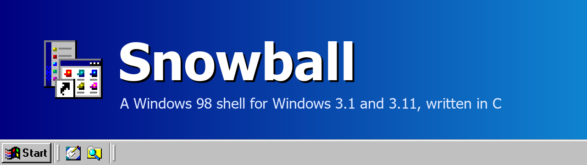
</p>

<p align="center">
  
  
  
  <a href="LICENSE"></a>
  <a href="https://ko-fi.com/focsy"></a>
</p>

<p align="center">
  A replacement for Program Manager that gives Windows 3.1 and 3.11 the desktop, taskbar and folders of Windows 98.<br>
  A reimplementation of Calmira, rewritten from scratch in C.
</p>

<p align="center">
  <a href="#the-shell">The Shell</a> ·
  <a href="#why-this-exists">Why This Exists</a> ·
  <a href="#snowball-and-calmira">Snowball and Calmira</a> ·
  <a href="#features">Features</a> ·
  <a href="#roadmap">Roadmap</a> ·
  <a href="#getting-started">Getting Started</a> ·
  <a href="#building-from-source">Building</a> ·
  <a href="#ideas-bugs-and-questions">Feedback</a> ·
  <a href="#license">License</a>
</p>

---

## The Shell

Snowball runs as the shell of Windows 3.1 or Windows for Workgroups 3.11, in place of Program Manager. You get a
desktop with icons, a taskbar with a Start menu, folder windows and Explorer, and the Properties sheets that go with
them, all drawn the way Windows 98 Second Edition drew them. Your Windows 3.1 programs keep running as before, and
while Snowball is the shell they get Windows 98 captions, buttons and menus too.

It runs on real hardware or in an emulator such as DOSBox-X.

<p align="center">
  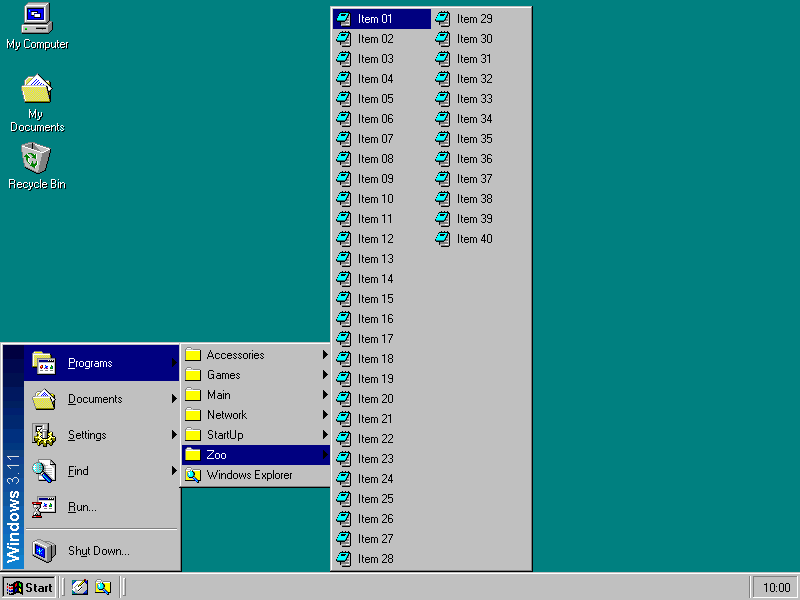
  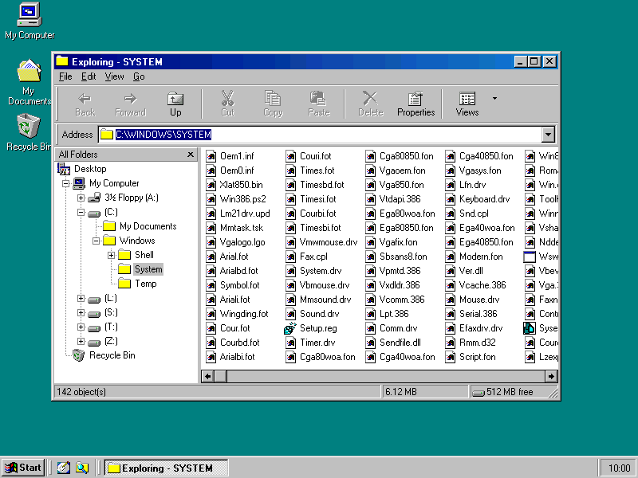
</p>

---

## Why This Exists

Calmira did this first, in 1997: a Windows 95 shell for Windows 3.1, written in Delphi 1. It is still the best known
shell of its kind, and later projects kept it going. But Delphi's class library sits under every window, the program
is a single 1,229 KB executable, and on a system whose USER and GDI heaps are 64 KB each, every window it opens costs
more than it has to.

Snowball started as a port and became a rewrite. Every part was written again in C, against the Windows 3.1 API
directly, with no class library in between. The goal is the same as Calmira's, with the look moved forward to
Windows 98 and the footprint pushed down.

---

## Snowball and Calmira

<p align="center">
  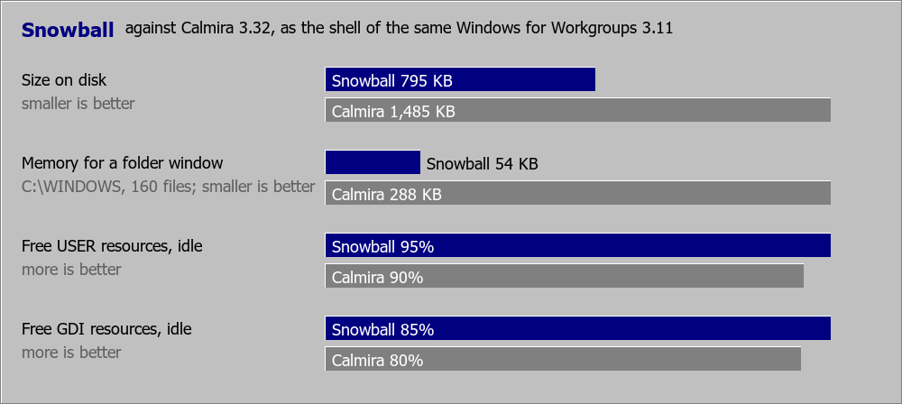
</p>

### On Disk

Snowball is split by job: a 4 KB starter, the shell in a library, a small library that every program loads for the
hooks and the Windows 98 look, and the pictures in a library of their own. Calmira keeps almost everything in one
program.

| Part | Snowball | Size | Calmira | Size |
|:---|:---|---:|:---|---:|
| The shell | SNOWBALL.EXE and SNSHELL.DLL | 337 KB | CALMIRA.EXE | 1,229 KB |
| Loaded into every program | SNSYSTEM.DLL | 28 KB | WNDHOOKS.DLL | 5 KB |
| Long file names | LFN.DRV (optional) | 7 KB | LFNFUNCS.DLL | 191 KB |
| Helpers | OPEN.COM | 3 KB | CTASKMAN.EXE, EXPLORER.EXE, SCRNSAVE.EXE, SHOWDESK.EXE | 60 KB |
| Icons and pictures | W98ART.DLL, 239 icons | 419 KB | inside CALMIRA.EXE | |
| **Total** | | **795 KB** | | **1,485 KB** |

### Running

Each was the shell of the same Windows for Workgroups 3.11 (DOSBox-X, 800x600) and went through the same script:
idle after start, then with C:\WINDOWS (160 files) open in a folder window. Snowball v20261025, Calmira 3.32.

| Measured | Snowball | Calmira |
|:---|---:|---:|
| Free GDI resources, idle | **85%** | 80% |
| Free USER resources, idle | **95%** | 90% |
| Free memory, idle | **246,573 KB** | 246,412 KB |
| Memory the folder window takes | **54 KB** | 288 KB |
| Free GDI resources, folder open | **81%** | 77% |
| Free USER resources, folder open | **95%** | 88% |

Windows 3.1 runs out of USER and GDI space long before it runs out of memory, so those two percentages decide how
many programs and windows you can keep open.

---

## Features

Everything Snowball does. Features marked with \* are in Calmira too.

### Desktop

| Feature | What it does |
|:---|:---|
| Desktop icons \* | My Computer, My Documents, the Recycle Bin, shortcuts and files, arranged by hand or by name |
| Shadowed labels | White labels with a black shadow, readable on any wallpaper |
| Right-click menu | Arrange Icons by name, type, size or date, and the desktop's Properties |
| Display Properties | Background (wallpaper centred or tiled, with a preview), Screen Saver, Appearance (colour schemes), Settings (colours and screen size) |
| The Windows 98 look everywhere | Every program's captions with their gradient, its buttons, check boxes, combo boxes, scroll arrows and menus, while Snowball is the shell |

### Taskbar and Start Menu

| Feature | What it does |
|:---|:---|
| Taskbar \* | A button for each window, flashing when its program asks for attention, always on top or hidden until the mouse comes |
| Any screen edge | Bottom, top, left or right, one row or several, and resized by dragging its edge |
| Icons only | Buttons with just the program's icon, the Start button with just its flag (option) |
| Grouping | A program's windows on one button with a count; resting on it or clicking it lists them (option) |
| Quick Launch | Show Desktop and the shortcuts of its folder beside the Start button; files dropped on it become shortcuts |
| Tray and clock | Chosen programs as icons in the tray; the clock's tip shows the date, a double click opens Date & Time |
| Start menu \* | Programs, Documents, Settings, Find, Help, Run and Shut Down, long submenus in columns, submenus that open as the mouse rests |
| Start menu editing \* | Drag items to move them, right-click them to rename, delete or see their properties, without the menu closing |
| Documents | The last 15 documents you opened, from folders or the Run box |
| Run \* | With AutoComplete of paths and programs |
| Shut Down \* | Windows 98's Shut Down dialog |
| Alt+Tab | Windows 98's switcher, through the taskbar's windows |
| Windows key | Alone the Start menu; with E My Computer, R Run, F Find, M Minimize All, D Show Desktop, Break System Properties |
| Task Manager \* | Ctrl+Shift+Esc: programs and windows, their processor use, ending one that hangs |

### Folders and Explorer

| Feature | What it does |
|:---|:---|
| Folder windows \* | Browse in place with Back, Forward and Up, Windows 98's Standard Buttons, an address bar and a status bar |
| Views \* | Large Icons, Small Icons, List and Details, sorted by a click on a column |
| Thumbnails | Pictures shrunk into the folder view |
| Explorer \* | The folder tree beside the folder, with each item's own right-click menu |
| Address bar AutoComplete | Folders listed as you type, as Windows 98 does |
| Compact toolbar | The address and the buttons on one line |
| Infotips | A description when the mouse rests on a file or folder |
| Folder icons and tips | A folder's own icon and tip from its desktop.ini |
| My Computer tiles | Drives as tiles with a bar of how full they are |
| Filter \* | Show only the names that match, such as `*.txt;*.bmp` |
| Folder Options | Full path in the title, hidden extensions, hidden files, one window or one per folder |
| File Types | The registered types, their icons and actions, edited as Windows 98 does |
| Find \* | Files and folders by name or part of it, by the text they contain, in subfolders too |
| Go To Folder \* | Ctrl+G |

### Files

| Feature | What it does |
|:---|:---|
| Copy, move and delete \* | With a progress window, asking before replacing, by menus, keys or drag and drop |
| Recycle Bin \* | Deleted files kept per disk, restored or emptied, with its own Properties |
| Undo | Ctrl+Z takes back the last 10 renames, moves, copies and deletes |
| Send To | The floppy, Desktop as Shortcut and anything you put in the Send To folder |
| Shortcuts \* | Made by dragging or Create Shortcut, with their own icon picked from any file |
| Shortcut keys | Ctrl+Alt+letter starts a shortcut from anywhere |
| Properties \* | Files, folders, drives with their used and free space, shortcuts, programs' version information, the computer |
| Quick View | A text or BMP file shown without opening a program |
| Open With | Pick the program for a file, once or always |
| Long file names \* | Folders show and keep long names; LFN.DRV gives them to plain Windows 3.1 programs too (option at setup) |

### Programs and Windows

| Feature | What it does |
|:---|:---|
| Open and Save As | Windows 98's dialogs, with long names, for every program that uses the common dialogs |
| Document windows | Windows 98's captions and minimized strips for the windows inside programs such as File Manager |
| Program Manager \* | Its groups become Start menu folders, and setup programs that talk to Program Manager still work |
| Shared clipboard | Text copied in Windows can be pasted on the host and back (DOSBox-X) |
| OPEN.COM | `OPEN .` or `OPEN file` in an MS-DOS Prompt window opens it in Snowball |
| Sounds | Snowball's events in Control Panel's Sounds |
| Setup \* | One SNOWSET.EXE that installs into any Windows 3.1 or 3.11, with an uninstaller |

### Gallery

<table>
  <tr>
    <td align="center" width="50%">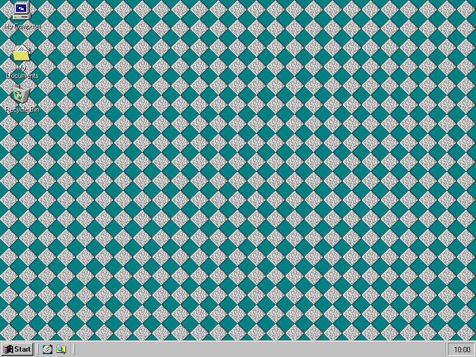<br><sub>Shadowed labels on a tiled wallpaper</sub></td>
    <td align="center" width="50%">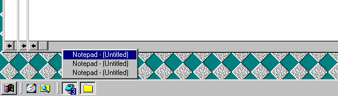<br><sub>Icons only and grouping: three Notepads on one button</sub></td>
  </tr>
  <tr>
    <td align="center">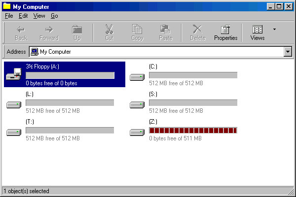<br><sub>My Computer's drive tiles</sub></td>
    <td align="center">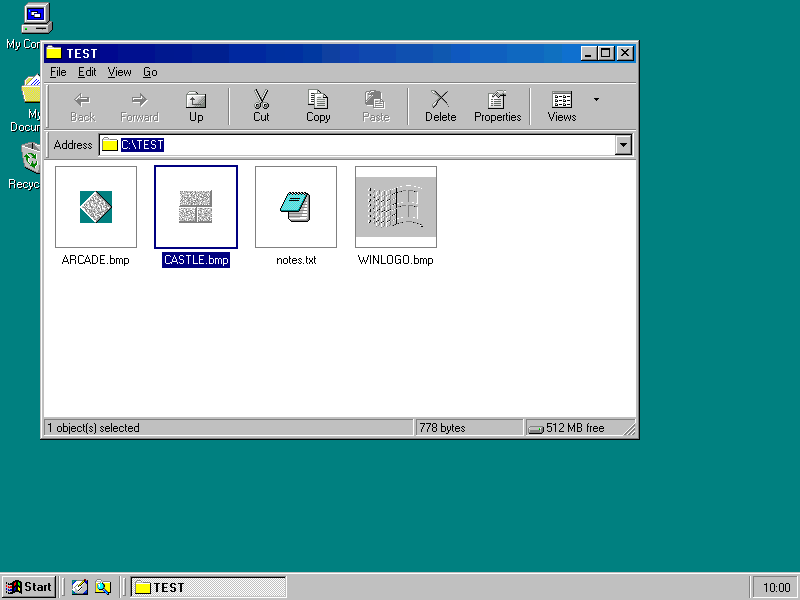<br><sub>Thumbnails</sub></td>
  </tr>
  <tr>
    <td align="center">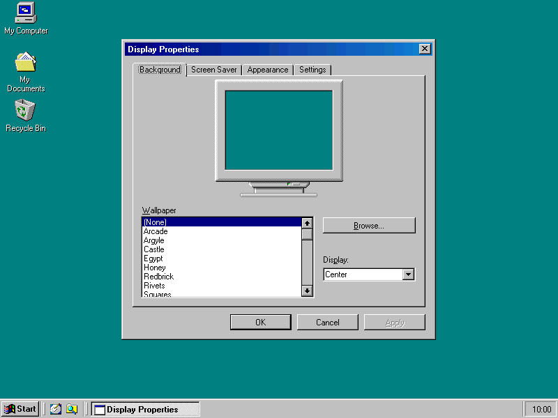<br><sub>Display Properties</sub></td>
    <td align="center">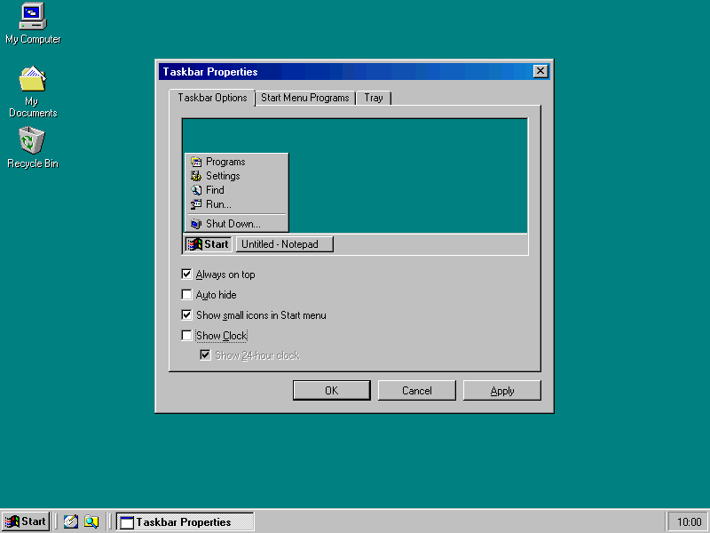<br><sub>Taskbar Properties</sub></td>
  </tr>
  <tr>
    <td align="center">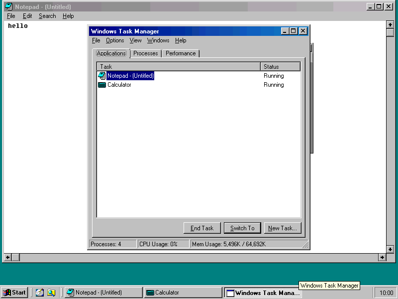<br><sub>Task Manager</sub></td>
    <td align="center">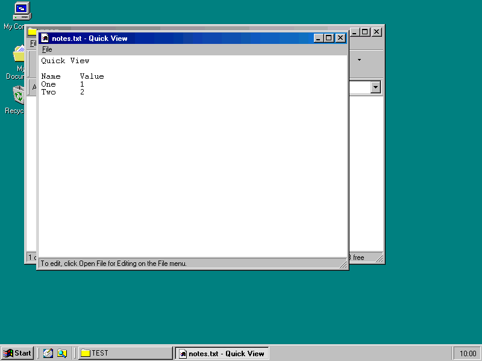<br><sub>Quick View</sub></td>
  </tr>
</table>

---

## Roadmap

| # | Feature | What it means | Status |
|:-:|:---|:---|:-:|
| 1 | Control Panel as a folder | Control Panel's applets as icons in a folder window, as Windows 98 shows them | Idea |
| 2 | Network Neighborhood | Windows for Workgroups' shared folders and printers on the desktop and in Explorer | Idea |
| 3 | Window previews | A small picture of each window in a group's list on the taskbar | Idea |
| 4 | Mounting from the shell | Host folders and disk images mounted from Snowball itself | Idea |

---

## Getting Started

### What You Need

- Windows 3.1 or Windows for Workgroups 3.11, in 386 enhanced mode
- About 1 MB of disk space

### Install

1. Get `SNOWSET.EXE` from the [Releases](../../releases) page.
2. Run it inside Windows. It asks where to put Snowball and whether to install the long file name driver.
3. Restart Windows. Snowball starts in place of Program Manager.

To go back to Program Manager, run Uninstall Snowball from the Snowball folder of the Start menu.

---

## Building from Source

You need Windows with PowerShell. The tools are found where they are usually installed, or downloaded on first use
into `build-tools\`: Open Watcom 2 for the code, Inno Setup 1.2.16 and winevdm for the setup.

```powershell
.\build.ps1        # SNOWBALL.EXE, SNSHELL.DLL, SNSYSTEM.DLL and the rest, in release\
.\makesetup.ps1    # setup\SNOWSET.EXE
.\unittest.ps1     # the core's checks, in under a second
```

---

## Ideas, Bugs and Questions

[Open an issue](../../issues). For a bug, say what you did, what you expected and what happened, and which Windows and
which machine or emulator you use.

---

## License

Snowball is free software under the [GNU General Public License, version 2](LICENSE).

Inspired by Calmira. Snowball's own icon comes from Calmira (GPL). W98ART.DLL holds pictures taken from Windows 98
Second Edition's own files.

Copyright (C) 2026 [iFocsy](https://github.com/iFocsy/snowball-shell)
