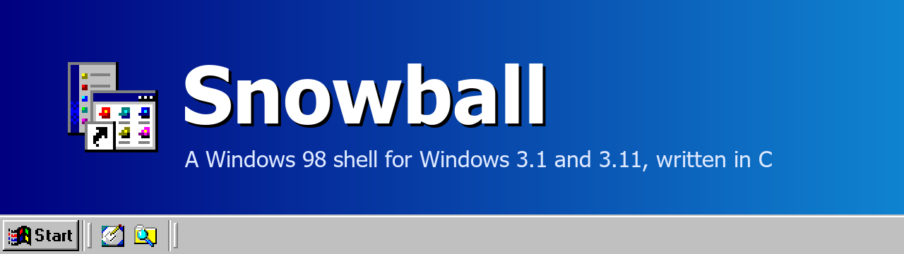
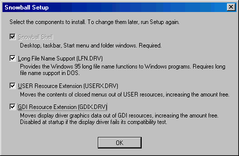
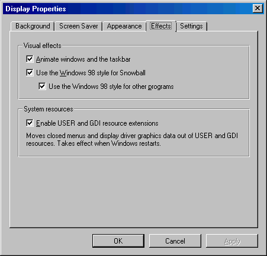

<p align="center">
  
</p>

# Drivers

Snowball comes with three optional drivers for Windows 3.1. Each is a separate file that Windows loads
at startup, through the `drivers=` line of SYSTEM.INI. They change no Windows files and do not depend
on Snowball: they also work with Program Manager or any other shell.

The drivers are distributed as binaries in the `redist` folder. Their source code is not part of this
repository.

[Back to the README](../README.md)

| Driver | File | Size | Purpose |
|:---|:---|---:|:---|
| [Long File Name Support](#long-file-name-support) | LFN.DRV | 7 KB | Long file names for Windows programs |
| [USER Resource Extension](#user-resource-extension) | USERX.DRV | 10 KB | More free USER resources |
| [GDI Resource Extension](#gdi-resource-extension) | GDIX.DRV | 5 KB | More free GDI resources |

- [Installing](#installing)
- [Long File Name Support](#long-file-name-support)
- [System Resources](#system-resources)
- [USER Resource Extension](#user-resource-extension)
- [GDI Resource Extension](#gdi-resource-extension)
- [Turning a Driver Off](#turning-a-driver-off)

---

## Installing

Snowball Setup lists the drivers as components. To change the selection later, run Setup again: a
driver that is no longer selected is removed. The uninstaller removes the drivers Setup added.

<p align="center">
  
</p>

To install a driver by hand, copy it to `WINDOWS\SYSTEM` and add it to SYSTEM.INI:

```ini
[boot]
drivers=mmsystem.dll lfn.drv userx.drv gdix.drv
```

---

## Long File Name Support

LFN.DRV gives Windows programs the long file name functions of Windows 95. Windows 3.1 cannot pass
those calls from a Windows program to DOS by itself, even when DOS supports them.

- Windows programs written for long file names can use them as they would under Windows 95.
- Older programs can open files in folders with long names, because long paths are translated for
  them. `[lfn.drv] LongPaths=0` in SYSTEM.INI turns this part off.
- Requires a DOS with long file names: DOSBox-X with `lfn = true`, or a DOS long file name driver.
  Without one the driver does nothing.

---

## System Resources

Windows 3.1 keeps its windows, menus and graphics data in small memory areas of 64 KB at most. The
percentage of free system resources shown in About boxes, and in Snowball's Resource Meter, is what is
left in the fullest of them. When it runs low, programs fail to start or windows fail to draw, however
much memory the computer has.

Windows has two groups of these areas: USER, for windows and menus, and GDI, for graphics. The two
Resource Extensions move data out of them into memory of their own. Programs do not notice.

Free resources at the end of two test sessions, at 16-bit colour:

| Session | | Without the drivers | With both drivers |
|:---|:---|---:|---:|
| 15 programs, 4 folder windows, Start menu open | USER | 57% | **70%** |
| | GDI | 62% | **68%** |
| 24 Explorer windows | USER | 25% | **68%** |
| | GDI | 81% | **85%** |

---

## USER Resource Extension

Windows keeps the contents of every menu of every program in USER resources all the time, including
menus nobody has open. These are the first USER resources to run out.

USERX.DRV moves the contents of closed menus to its own memory, about 2.3 times smaller, and returns
them the moment a menu opens. Programs see their menus as usual: they can read, enable, check, change
and delete items at any time, and keyboard shortcuts work as before.

These stay in USER resources:

- Menus that are open, and those used in the last few seconds
- Menu bars themselves, and the Control menus of windows
- The Window menus of programs with document windows, such as File Manager

The limit after that is USER's data for windows themselves, which this driver does not move.

Memory used: the driver, plus about 9 KB with 15 programs and 4 folder windows open.

**Compatibility.** The driver checks how USER.EXE stores menus each time Windows starts, and stays
disabled if it does not recognise it. Tested with Windows for Workgroups 3.11.

---

## GDI Resource Extension

For each fill colour and pattern in use, the display driver prepares a block of graphics data, and
Windows keeps it in GDI resources: 83 bytes at 256 colours, 147 at 16-bit colour, 275 at 32-bit colour.

GDIX.DRV moves that data to its own memory. GDI resources keep only a 6-byte reference to it. The gain
grows with the colour depth, and with the number of colours and patterns programs have in use:

| Display | Fill objects held at once, without the driver | With the driver |
|:---|---:|---:|
| 16-bit colour | 214 | **496** |
| 256 colours | 313 | **682** |
| 16 colours (Windows' VGA driver) | 402 | **686** |

The driver works between Windows and the display driver, and no display driver is modified.

**Compatibility.** Each time Windows starts, the driver draws test patterns the normal way and through
its own memory, and compares the results. If they differ it restores everything and stays disabled for
that session. The Effects tab reports this, so a display driver can be checked just by trying it.

Tested with VBESVGA at 256 colours and 16-bit colour, and with Windows' own VGA driver.

Once active, the driver stays in memory until Windows exits.

---

## Turning a Driver Off

The Effects tab of Display Properties turns both Resource Extensions on or off. It also reports a
driver that disabled itself at startup. The change takes effect when Windows restarts.

<p align="center">
  
</p>

The same settings in SYSTEM.INI, without removing the drivers:

```ini
[userx.drv]
Enabled=0

[gdix.drv]
Enabled=0
```

Both drivers need a 386 or later and no math coprocessor. They have been tested in 386 enhanced mode.
