

  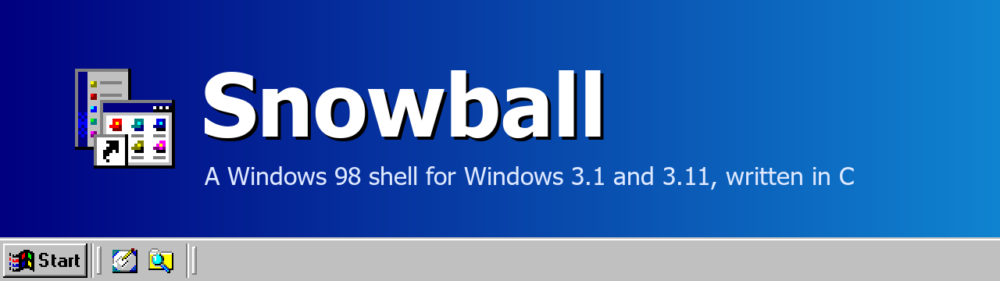

# Features

Everything Snowball does, area by area. Features marked with \* are in Calmira too.

[Back to the README](../README.md)

- [Desktop and Appearance](#desktop-and-appearance)
- [Taskbar and Start Menu](#taskbar-and-start-menu)
- [Folders and Explorer](#folders-and-explorer)
- [Files](#files)
- [Programs and Windows](#programs-and-windows)

---

## Desktop and Appearance

<table>
  <tr>
    <td width="44%" valign="top">
      <b>The Windows 98 UI</b>
      
While Snowball is the shell, every program gets Windows 98's captions with their gradient, raised buttons,
      check boxes, combo boxes, scroll arrows and etched menus. Menus follow the mouse and close at a right click
      elsewhere, which then opens the menu there. Display Properties' Effects turn the style off for other programs,
      or for Snowball's own windows too, at once.

    </td>
    <td>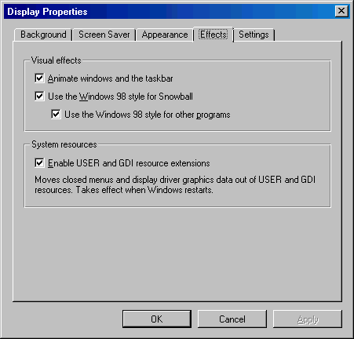</td>
  </tr>
  <tr>
    <td valign="top">
      <b>Display Properties</b>
      
Background (a BMP, JPEG or PNG wallpaper, filling the screen, fitted, stretched, tiled or centred, shown on a
      monitor first; a photo larger than the screen is made to fit, and made again if the screen changes), Screen Saver, Appearance (a scheme, or
      each item's colours, Color 2 of title bars, tooltips), Effects and Settings (colours and screen area for the
      VBE driver).

    </td>
    <td>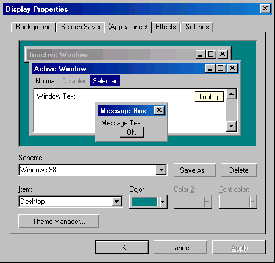</td>
  </tr>
  <tr>
    <td valign="top">
      <b>Theme Manager</b>
      
Windows 98's Desktop Themes, with every part editable. A theme sets any of: colours, wallpaper, screen saver,
      sounds, mouse pointers and the desktop's icons. Themes are listed in groups, made from the settings in use,
      copied, renamed and deleted, and imported from or exported to Windows 98's <code>.Theme</code> files. Apply a
      whole theme or only some of its parts. Start > Settings, or Appearance's Theme Manager button.

    </td>
    <td>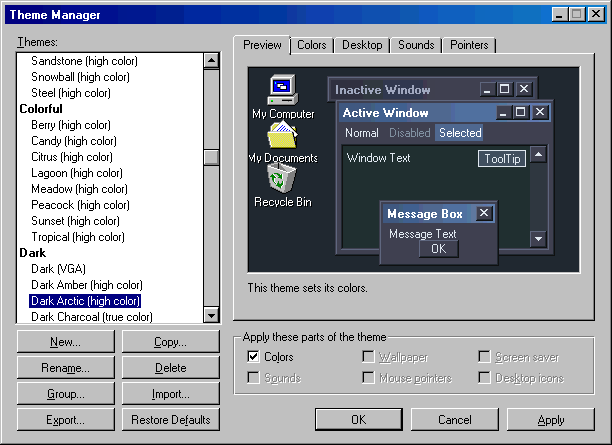</td>
  </tr>
  <tr>
    <td valign="top">
      <b>Every colour of a scheme</b>
      
All 27 colours by name, Windows 98's six included (title bars' Color 2, tooltips, dark shadow, hot tracking),
      each changed from Windows 98's colour palette.

    </td>
    <td>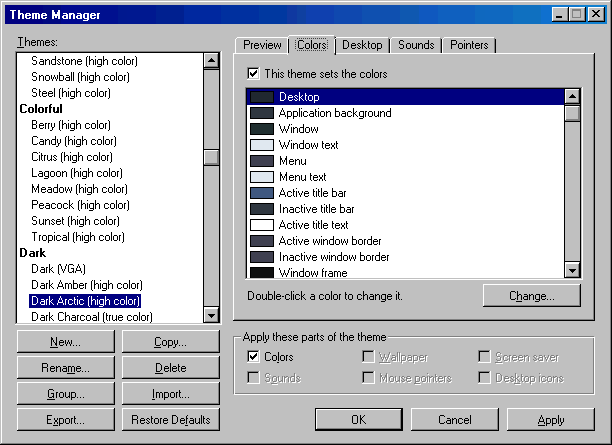</td>
  </tr>
  <tr>
    <td valign="top">
      <b>Wallpaper, screen saver, icons, sounds, pointers</b>
      
A picture in any wallpaper style, any screen saver, My Computer's, My Documents' and the Recycle Bin's icons, a sound
      for each of 15 events, and ten mouse pointers. Windows 3.1 has no way to change its pointers; Snowball changes
      their shapes from <code>.CUR</code> files or an <code>.ANI</code>'s first frame, in black and white as Windows
      3.1 draws them.

    </td>
    <td>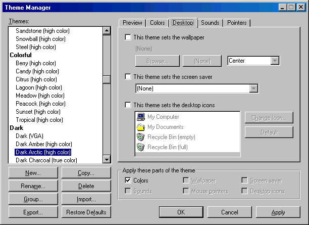</td>
  </tr>
  <tr>
    <td valign="top">
      <b>60 colour schemes</b>
      
Windows 98's own and its classics (Brick, Rainy Day, Spruce...); the colours of Windows 2000, XP (Blue, Olive
      Green, Silver, Royale, Zune) and Vista and 7; and Snowball's own: light (Autumn, Ocean, Sage...), colourful
      (Tropical, Sunset, Lagoon, Peacock...) and dark (Dark Charcoal, Dark Arctic, Dark Forest, Dark Neon...), checked
      for readable contrast. Each name says the colours it needs: (VGA), (high color) or (true color).

    </td>
    <td>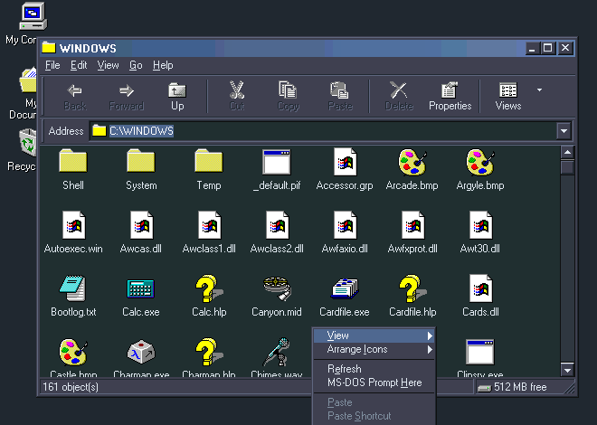</td>
  </tr>
</table>

| Feature | What it does |
|:---|:---|
| Desktop icons \* | My Computer, My Documents, the Recycle Bin, shortcuts and files, arranged by hand or by name |
| Shadowed labels | White labels with a black shadow, readable on any wallpaper |
| Right-click menu | Arrange Icons by name, type, size or date, Refresh, New, Paste, and the desktop's Properties |
| Animations | Windows zoom to and from their taskbar buttons; the hidden taskbar slides in (Effects turns them off) |
| Plain title bars on 256 colours | As Windows 98: gradients only where the screen has the colours for them |

---

## Taskbar and Start Menu

<table>
  <tr>
    <td width="44%" valign="top">
      <b>Taskbar</b> *
      
A button for each window, flashing when its program asks for attention; on any screen edge, one row or
      several, resized by dragging its edge; always on top or hidden until the mouse comes; locked in place.
      Quick Launch, the tray and the clock sit beside it.

    </td>
    <td>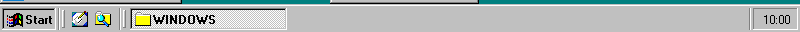  
        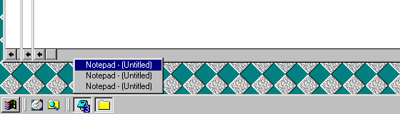</td>
  </tr>
  <tr>
    <td valign="top">
      <b>Taskbar Properties</b>
      
Its options with a picture of the result, the Start menu's programs (Add, Remove, Advanced, Clear), and the
      tray: programs that show as icons by the clock, and programs kept off the taskbar.

    </td>
    <td>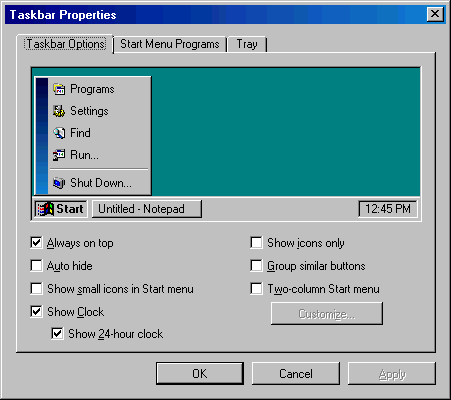</td>
  </tr>
  <tr>
    <td valign="top">
      <b>Two-column Start menu</b>
      
Windows XP's Start menu in its classic look: programs pinned to it and those started most on the left, All
      Programs with its submenu beside it, the places and commands on the right, Shut Down in the bottom band. Its
      items have a menu of their own (Open, Pin, Remove from This List, Properties).

    </td>
    <td>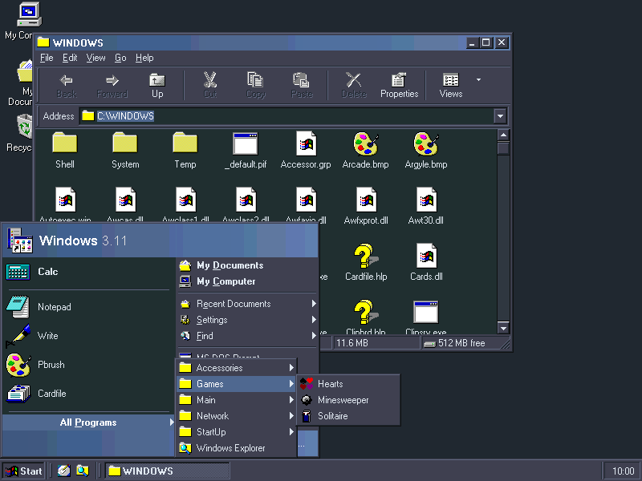</td>
  </tr>
  <tr>
    <td valign="top">
      <b>Customize Start Menu</b>
      
How many of the programs used most it lists, which sets its height, and how wide it is; Clear List forgets
      them.

    </td>
    <td>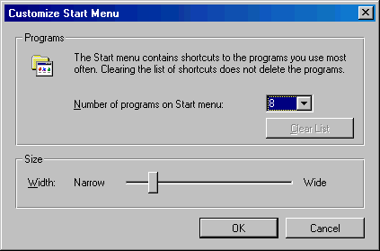</td>
  </tr>
  <tr>
    <td valign="top">
      <b>Alt+Tab</b>
      
Windows 98's switcher, through the taskbar's windows, in place of Windows 3.1's.

    </td>
    <td>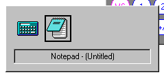</td>
  </tr>
  <tr>
    <td valign="top">
      <b>Task Manager</b> *
      
Ctrl+Shift+Esc. Applications, processes with their memory, and performance: processor use in total and per
      program, memory and free resources, with history graphs. Ends a program that hangs.

    </td>
    <td>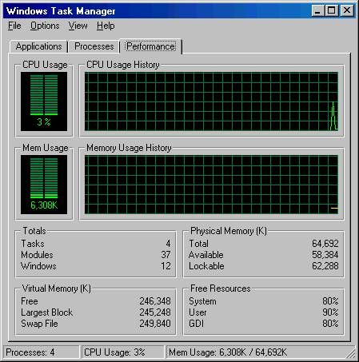</td>
  </tr>
  <tr>
    <td valign="top">
      <b>Date/Time Properties</b>
      
A double click on the clock: a calendar and a clock face; 12 or 24 hours as Windows' International settings
      say.

    </td>
    <td>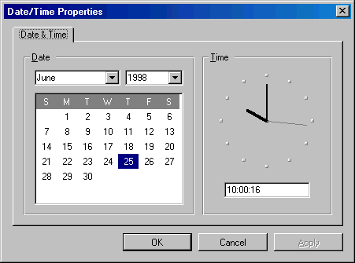</td>
  </tr>
</table>

| Feature | What it does |
|:---|:---|
| Start menu \* | Programs, Documents, Settings, Find, Help, Run and Shut Down; long submenus in columns; submenus open as the mouse rests |
| Start menu editing \* | Drag items to move them, right-click them to rename, delete or see their properties; the menu opens again where it was |
| Icons only | Buttons with just the program's icon, the Start button with just its flag (option) |
| Grouping | A program's windows on one button with a count; resting on it or clicking it lists them (option) |
| Quick Launch | Show Desktop and the shortcuts of its folder beside the Start button; files dropped on it become shortcuts |
| Tray and clock | Chosen programs as icons in the tray; the clock's tooltip shows the date |
| Resource Meter | The free System, User and GDI resources as three bars in the tray, with their details |
| Volume | A speaker in the tray when the sound driver can set the volume: a slider and Mute |
| Documents | The last 15 documents opened, from folders or the Run box |
| Run \* | With AutoComplete of paths and programs |
| Shut Down \* | Windows 98's Shut Down dialog |
| Windows key | Alone, the Start menu; with E My Computer, R Run, F Find, M Minimize All, D Show Desktop, Break System Properties |
| Snap | Win+Left or Win+Right puts a window on half the screen, Win+Up maximizes, Win+Down restores; dropping a window at the screen's edge does the same |
| Always on Top | From a taskbar button's menu, that window stays above the others |

---

## Folders and Explorer

<table>
  <tr>
    <td width="44%" valign="top">
      <b>Folder windows</b> *
      
Back, Forward and Up, Windows 98's Standard Buttons and address bar with AutoComplete, and a status bar with
      the drive's free space. Large Icons, Small Icons, List, Details (sorted by a click on a column, resizable) and
      Thumbnails. Each folder remembers its own view.

    </td>
    <td>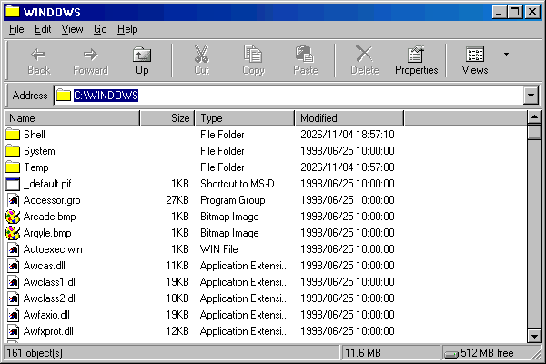</td>
  </tr>
  <tr>
    <td valign="top">
      <b>Explorer</b> *
      
The folder tree beside the folder, each item with its own menu; from Quick Launch, or from any folder's View
      menu.

    </td>
    <td>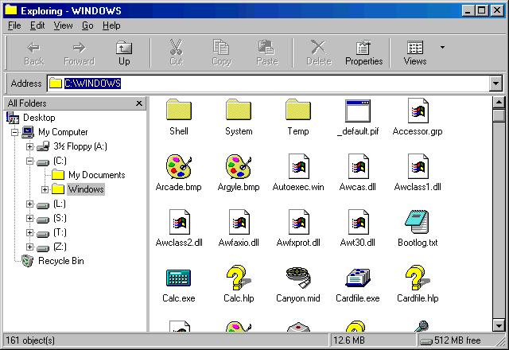</td>
  </tr>
  <tr>
    <td valign="top">
      <b>Thumbnails</b>
      
Bitmaps shrunk into the folder view.

    </td>
    <td>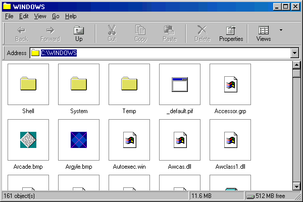</td>
  </tr>
  <tr>
    <td valign="top">
      <b>My Computer</b>
      
Drives as tiles, each with a bar of how full it is and its free space.

    </td>
    <td>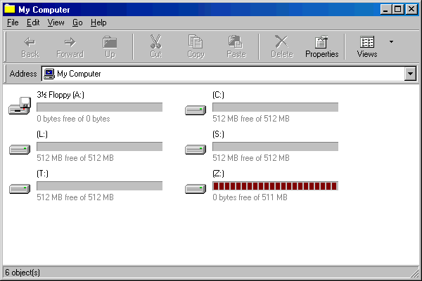</td>
  </tr>
  <tr>
    <td valign="top">
      <b>Context menus</b> *
      
Open, Explore, Find, MS-DOS Prompt Here, Send To, Cut, Copy, Paste, Create Shortcut, Delete, Rename and
      Properties, with each file type's own actions; a floppy's adds Format and Copy Disk.

    </td>
    <td>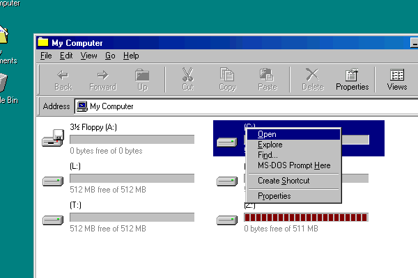</td>
  </tr>
  <tr>
    <td valign="top">
      <b>Folder Options</b>
      
One window for all folders or one each, single-click to open, the full path in the title, hidden extensions
      and files, infotips, each folder's own view (Like Current Folder, Reset All Folders), and File Types.

    </td>
    <td>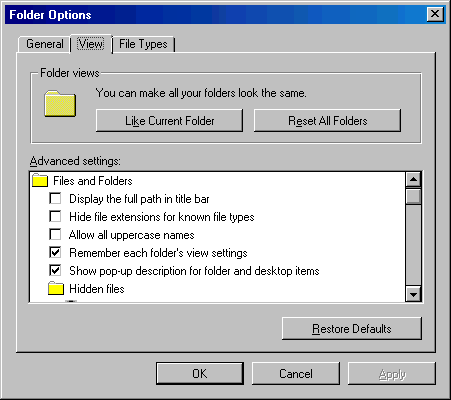</td>
  </tr>
  <tr>
    <td valign="top">
      <b>Find</b> *
      
Files and folders by name or part of it and by the text they contain, in subfolders too; the results as a
      folder view.

    </td>
    <td>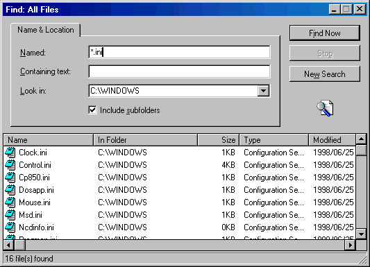</td>
  </tr>
</table>

| Feature | What it does |
|:---|:---|
| Compact toolbar | The address and the buttons on one line |
| Mouse wheel | Scrolls folders and the folder tree, with a mouse driver that has a wheel, such as VBMOUSE |
| Dates | File dates and times as Windows' International settings show them |
| Infotips | A description when the mouse rests on a file or folder |
| Folder icons and tips | A folder's own icon and tip from its desktop.ini |
| Filter \* | Show only the names that match, such as `*.txt;*.bmp` |
| File Types | The registered types, their icons and actions, edited as Windows 98 does |
| Go To Folder \* | Ctrl+G |

---

## Files

<table>
  <tr>
    <td width="44%" valign="top">
      <b>Properties</b> *
      
Files, folders, shortcuts, programs' version information, the computer, and drives with their used and free
      space, a pie and Disk Cleanup.

    </td>
    <td>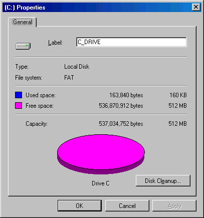</td>
  </tr>
  <tr>
    <td valign="top">
      <b>Quick View</b>
      
A text or bitmap file shown without opening a program.

    </td>
    <td>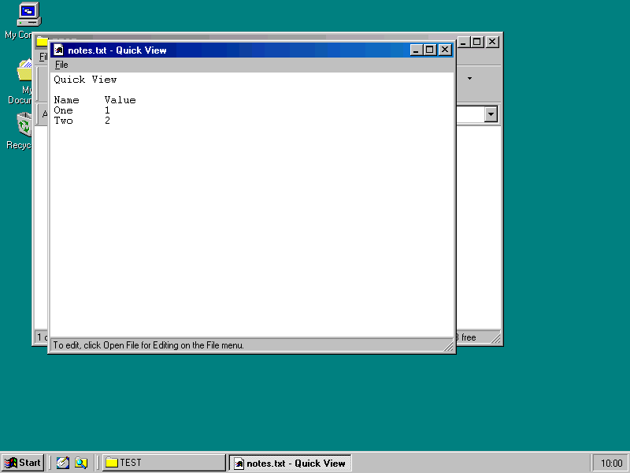</td>
  </tr>
</table>

| Feature | What it does |
|:---|:---|
| Copy, move and delete \* | With a progress window, asking before replacing, by menus, keys or drag and drop |
| Recycle Bin \* | Deleted files kept per disk, restored or emptied, with its own Properties |
| Undo | Ctrl+Z takes back the last 10 renames, moves, copies and deletes |
| Send To | The floppy, Desktop as Shortcut and anything put in the Send To folder |
| Shortcuts \* | Made by dragging or Create Shortcut, with their own icon picked from any file |
| Shortcut keys | Ctrl+Alt+letter starts a shortcut from anywhere |
| Format and Copy Disk | A floppy's menu: Windows 98's Format dialog, or DISKCOPY run by DOS in a window |
| Disk Cleanup | Temporary files, a drive's Recycle Bin and old ScanDisk files, with their sizes; offered when a disk is nearly full |
| Open With | Pick the program for a file, once or always |
| Long file names \* | Folders show and keep long names; [LFN.DRV](DRIVERS.md#long-file-name-support) gives them to plain Windows 3.1 programs too (optional at setup); Snowball's own folders made before there were long names take theirs |
| USER and GDI Resource Extensions | USERX.DRV and GDIX.DRV leave more system resources free for every program: with 24 Explorer windows open, USER stays at 68% free instead of 25% (optional at setup; see [Drivers](DRIVERS.md)) |

---

## Programs and Windows

<table>
  <tr>
    <td width="44%" valign="top">
      <b>Open and Save As</b>
      
Windows 98's dialogs, with long names, for every program that uses Windows' common dialogs.

    </td>
    <td>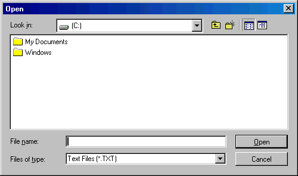</td>
  </tr>
  <tr>
    <td valign="top">
      <b>MS-DOS Prompt</b>
      
In a window, as Windows 98 opens it, from the Start menu or a folder's MS-DOS Prompt Here. Its Close button
      ends it, after Windows asks; Windows 3.1 refused.

    </td>
    <td>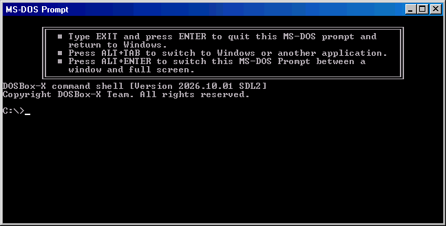</td>
  </tr>
</table>

| Feature | What it does |
|:---|:---|
| Document windows | Windows 98's captions and minimized strips for the windows inside programs such as File Manager |
| Program Manager \* | Its groups become Start menu folders, and Sync in Taskbar Properties brings in what it gained or changed since (only that: changes made in the Start menu stay); opening a .GRP file adds that group; setup programs that talk to Program Manager still work |
| Shared clipboard | Text copied in Windows can be pasted on the host and back (DOSBox-X) |
| OPEN.COM | `OPEN .` or `OPEN file` in an MS-DOS Prompt window opens it in Snowball |
| Sounds | Snowball's events in Control Panel's Sounds and in themes |
| Setup \* | One SNOWSET.EXE that installs into any Windows 3.1 or 3.11, with an uninstaller |
